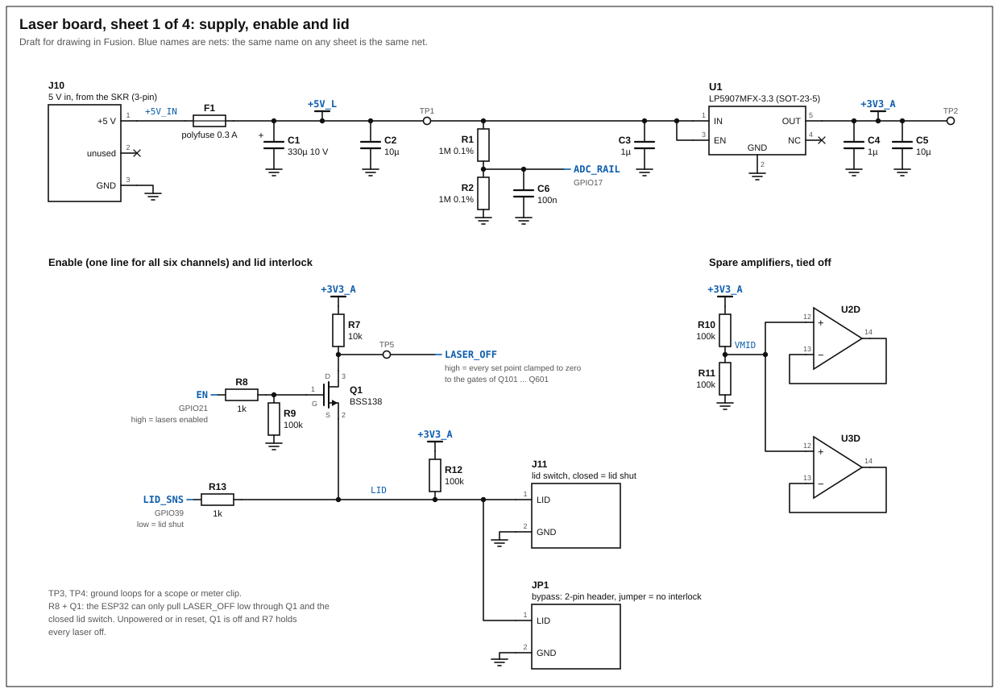
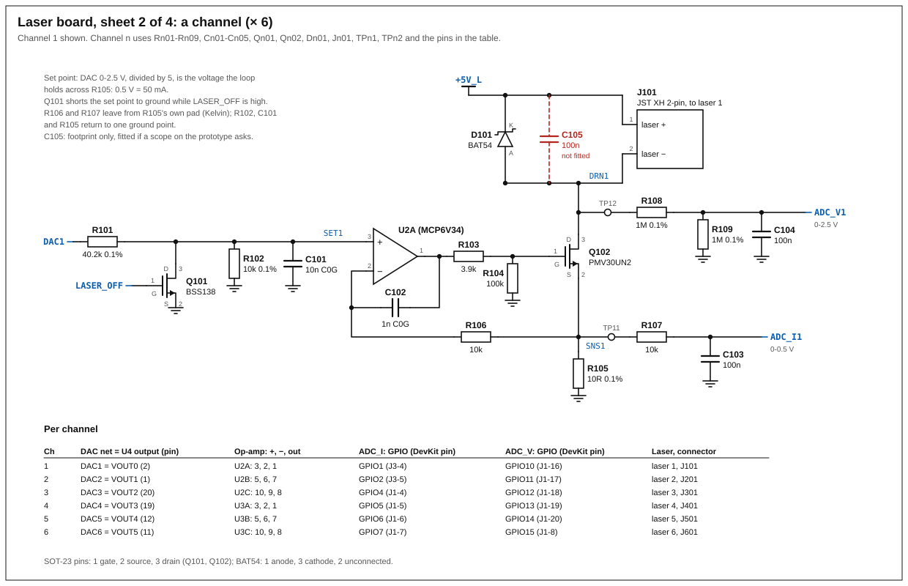
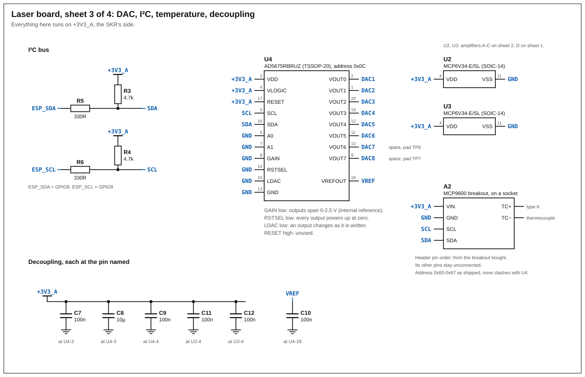
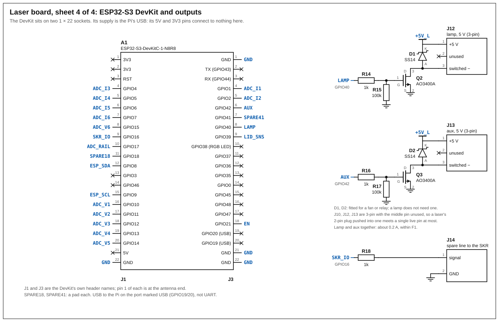

# Laser board: schematic (draft)

**A draft to draw from in Fusion (2026-11-12), nothing built.** It
turns the [laser board](laser-board.md) proposal and its bill of
materials into nets, designators and pin numbers. Four sheets:

1. [Supply, enable and lid](laser-board/laser-board-1-supply.svg)
2. [A channel, × 6](laser-board/laser-board-2-channel.svg)
3. [DAC, I²C, temperature, decoupling](laser-board/laser-board-3-dac.svg)
4. [ESP32-S3 DevKit and outputs](laser-board/laser-board-4-esp32.svg)

The sheets are drawn by `laser-board/sheets.py` (`python sheets.py .`
in that folder rewrites them). Once the board is drawn in Fusion, the
Fusion file is the schematic and these are history.

Pin numbers were checked against Analog's AD5675R datasheet (rev. B,
table 8) and Espressif's DevKitC-1 v1.1 guide. The others are the
standard ones for the package (SOT-23 MOSFET 1 gate, 2 source, 3 drain;
quad op-amp SOIC-14; LP5907 SOT-23-5) and **each is to be checked
against the Fusion library part used**: a SOT-23 symbol mapped to the
wrong pads is the classic mistake.

## What the schematic settles differently from the draft BoM

- **The enable goes through a MOSFET (Q1, with R8, R9).** The draft
  had GPIO21 pull the enable line low directly through 1 kΩ. With the
  Pi off and the SKR on, the unpowered ESP32's pin clamps that line
  through its protection diode to about 1 V: the BSS138 clamps (0.8 to
  1.5 V threshold) are then not surely on, and the DAC keeps its last
  value, so a laser lit when the Pi lost power could stay lit. Now the
  ESP32 only drives Q1's gate: unpowered or in reset, Q1 is off and R7
  holds every laser off. **GPIO21 high = lasers enabled.**
- **The lid switch sits between Q1 and ground**, and the ESP32 reads
  the same line (R12, R13). One wire of the lid cable is ground; a
  short of the other to ground acts as the bypass jumper, never as
  "lasers on".
- **A 10 nF at each set point (Cn01)**, after the divider: it filters
  the DAC's noise and the I²C's coupling into an 8 kΩ node. 80 µs, far
  below the 20 ms ramp, and it leaves chopping possible.
- **No 10 kΩ in the drain and rail readbacks**: 1 MΩ is already in
  series. Seven resistors fewer; the current readbacks keep theirs.
- **The two spare amplifiers** are followers at half the supply (R10,
  R11), as Microchip asks for unused ones.
- **Lamp and aux: about 0.2 A together, not 0.5 A each.** They take
  the 5 V after the polyfuse (0.3 A hold), so a shorted lamp cable
  trips it and cannot pull down the SKR's 5 V. A 5 V indicator takes
  20 mA. For a fan on aux, F1 becomes the 0.5 A one (MF-MSMF050-2).
- **The loop parts are 3.9 kΩ, 10 kΩ and 1 nF** (Rn03, Rn06, Cn02),
  not the draft's 220 Ω, 1 kΩ and 10 nF: simulated, the draft's
  oscillated ([below](#simulated-first)).
- **DAC decoupling** as its datasheet asks: 10 µF and 100 nF at VDD,
  100 nF at VLOGIC. C10 (100 nF on VREFOUT) is a footprint: the
  datasheet gives no value for it, so it is confirmed there before it
  is fitted.

Worth knowing, with no part added: the DAC's zero is 0.8 mV (1.6 mV at
most) above ground, so with the enable on, an unlit channel holds up to
0.3 mV on its sense resistor: **up to 30 µA through each unlit laser
while another is lit**. With every laser off the clamps hold them at
zero (under 1 µA, plus the dividers' 2.5 µA). If it ever shows, 3.3 MΩ
from the 3.3 V to each amplifier's inverting input puts 1 mV of dead
band there.

## Nets

| Net | What | Where |
|---|---|---|
| `+5V_IN` | the SKR's 5 V at the connector | J10, F1 |
| `+5V_L` | 5 V after the polyfuse: lasers, lamp, aux, LDO | sheets 1, 2, 4 |
| `+3V3_A` | analog 3.3 V from U1 | DAC, op-amps, pull-ups, MCP9600 |
| `GND` | one net, one pour | everywhere |
| `DAC1`-`DAC6` | DAC outputs, 0-2.5 V | U4 to Rn01 |
| `SET1`-`SET6` | set points, 0-0.5 V | Rn01, Rn02, Cn01, Qn01, op-amp + |
| `SNS1`-`SNS6` | sense resistor, 10 mV per mA | Qn02 source, Rn05, Rn06, Rn07 |
| `DRN1`-`DRN6` | laser − and sink drain | Jn01-2, Qn02, Dn01, Rn08 |
| `ADC_I1`-`ADC_I6` | current readbacks | Rn07, Cn03, ESP32 |
| `ADC_V1`-`ADC_V6` | drain readbacks, ÷2 | Rn08, Rn09, Cn04, ESP32 |
| `ADC_RAIL` | the rail, ÷2 | R1, R2, C6, GPIO17 |
| `LASER_OFF` | high = every set point clamped | R7, Q1, the six Qn01 gates |
| `EN` | GPIO21, high = enabled | R8 |
| `LID` | low = lid shut | Q1 source, J11, JP1, R12, R13 |
| `LID_SNS` | the lid, to GPIO39 | R13 |
| `SDA`, `SCL` | the bus, on `+3V3_A` | U4, A2, R3-R6 |
| `ESP_SDA`, `ESP_SCL` | GPIO8, GPIO9 | R5, R6 |
| `LAMP`, `AUX`, `SKR_IO` | GPIO40, 42, 16 | R14, R16, R18 |
| `VMID` | half of `+3V3_A` | R10, R11, U2D, U3D |
| `VREF` | the DAC's 2.5 V reference | U4-18, C10 |

## Parts by designator

Channel n (n = 1 to 6) uses the hundreds: R101 is channel 1's, R601
channel 6's.

| Ref | Value | Between |
|---|---|---|
| Rn01 | 40.2 kΩ 0.1 % | `DACn` and `SETn` |
| Rn02 | 10 kΩ 0.1 % | `SETn` and GND |
| Cn01 | 10 nF C0G | `SETn` and GND |
| Qn01 | BSS138 | drain `SETn`, source GND, gate `LASER_OFF` |
| Rn03 | 3.9 kΩ | op-amp output and Qn02's gate |
| Rn04 | 100 kΩ | Qn02's gate and GND |
| Qn02 | PMV30UN2 (or AO3400A) | drain `DRNn`, source `SNSn` |
| Rn05 | 10 Ω 0.1 % 25 ppm/K | `SNSn` and GND |
| Rn06 | 10 kΩ | `SNSn` and op-amp − |
| Cn02 | 1 nF C0G | op-amp output and op-amp − |
| Rn07 | 10 kΩ | `SNSn` and `ADC_In` |
| Cn03 | 100 nF | `ADC_In` and GND |
| Rn08, Rn09 | 1 MΩ 0.1 % | `DRNn` to `ADC_Vn`, `ADC_Vn` to GND |
| Cn04 | 100 nF | `ADC_Vn` and GND |
| Dn01 | BAT54 | anode `DRNn`, cathode `+5V_L` |
| Cn05 | 100 nF, not fitted | `+5V_L` and `DRNn` |
| Jn01 | JST B2B-XH-A | 1 `+5V_L` (laser +), 2 `DRNn` (laser −) |
| TPn1, TPn2 | test points | `SNSn`, `DRNn` |

| Ch | DAC output (U4 pin) | Op-amp: +, −, out | `ADC_I` | `ADC_V` |
|---|---|---|---|---|
| 1 | VOUT0 (2) | U2A: 3, 2, 1 | GPIO1 (J3-4) | GPIO10 (J1-16) |
| 2 | VOUT1 (1) | U2B: 5, 6, 7 | GPIO2 (J3-5) | GPIO11 (J1-17) |
| 3 | VOUT2 (20) | U2C: 10, 9, 8 | GPIO4 (J1-4) | GPIO12 (J1-18) |
| 4 | VOUT3 (19) | U3A: 3, 2, 1 | GPIO5 (J1-5) | GPIO13 (J1-19) |
| 5 | VOUT4 (12) | U3B: 5, 6, 7 | GPIO6 (J1-6) | GPIO14 (J1-20) |
| 6 | VOUT5 (11) | U3C: 10, 9, 8 | GPIO7 (J1-7) | GPIO15 (J1-8) |

Shared:

| Ref | Value | Between |
|---|---|---|
| J10 | JST B3B-XH-A (3-pin) | 5 V in: 1 `+5V_IN`, 2 unused, 3 GND |
| F1 | MF-MSMF030-2 | `+5V_IN` and `+5V_L` |
| C1, C2 | 330 µF 10 V, 10 µF | `+5V_L` and GND, at F1 |
| R1, R2, C6 | 1 MΩ, 1 MΩ, 100 nF | `+5V_L` ÷2 to `ADC_RAIL` |
| U1 | LP5907MFX-3.3 | 1 IN and 3 EN `+5V_L`, 2 GND, 5 OUT `+3V3_A`, 4 unconnected |
| C3, C4, C5 | 1 µF, 1 µF, 10 µF | U1's input; its output |
| U2, U3 | MCP6V34-E/SL | 4 `+3V3_A`, 11 GND; D of each: 12 `VMID`, 13 to 14 |
| U4 | AD5675RBRUZ | 3, 4, 17 `+3V3_A`; 5 `SCL`; 16 `SDA`; 6, 7, 8, 13, 14, 15 GND; 18 `VREF`; 10, 9 spare pads |
| C7, C8, C9 | 100 nF, 10 µF, 100 nF | at U4-3, U4-3, U4-4 |
| C10 | 100 nF, see above | `VREF` and GND |
| C11, C12 | 100 nF | at U2-4, U3-4 |
| R3, R4 | 4.7 kΩ | `SDA`, `SCL` to `+3V3_A` |
| R5, R6 | 330 Ω | `ESP_SDA` to `SDA`, `ESP_SCL` to `SCL` |
| R7 | 10 kΩ | `LASER_OFF` to `+3V3_A` |
| Q1 | BSS138 | drain `LASER_OFF`, source `LID`, gate through R8 from `EN` |
| R8, R9 | 1 kΩ, 100 kΩ | `EN` to Q1's gate; the gate to GND |
| R10, R11 | 100 kΩ | `+3V3_A` to `VMID` to GND |
| R12, R13 | 100 kΩ, 1 kΩ | `LID` to `+3V3_A`; `LID` to `LID_SNS` |
| J11, JP1 | JST B2B-XH-A; 2-pin header | 1 `LID`, 2 GND, in parallel |
| Q2, R14, R15, D1, J12 | AO3400A, 1 kΩ, 100 kΩ, SS14, JST B3B-XH-A (3-pin) | the lamp: J12-1 `+5V_L`, J12-2 unused, J12-3 Q2's drain |
| Q3, R16, R17, D2, J13 | the same | the aux output |
| R18, J14 | 1 kΩ, JST B2B-XH-A | `SKR_IO` to J14-1; J14-2 GND |
| A1 | ESP32-S3-DevKitC-1-N8R8 | two 1 × 22 sockets; sheet 4 |
| A2 | MCP9600 breakout | VIN `+3V3_A`, GND, `SCL`, `SDA`; a socket |
| TP1-TP7 | test points | `+5V_L`, `+3V3_A`, GND, GND, `LASER_OFF`, the two spare DAC outputs |

The DevKit's 3V3, 5V, RST, TX, RX and every GPIO not on sheet 4 stay
unconnected. Its four GND pins (J1-22, J3-1, J3-21, J3-22) all go to
GND.

## Drawing it in Fusion

- One sheet per sheet here, the same net names: a net label is a
  connection, so the DAC, the ESP32 and the channels need few long
  wires.
- Draw and lay out **one channel**, then reuse it six times (a design
  block, or a module if you prefer hierarchy). The six must end up
  identical on the board, which is the point of doing it that way.
- The DevKit and the MCP9600 breakout are sockets: a 1 × 22 pair for
  A1, a header for A2. **Measure the row spacing of the DevKit you
  have** before fixing the footprint (it and its clones differ), and
  take A2's pin order from the breakout bought.
- The AD5675R is unlikely to be in the stock libraries: import it
  (library.io, SnapEDA, Ultra Librarian) and check it against table 8
  of the datasheet.
- Mark Cn05 and the SS14s as not fitted in the BoM export, not by
  leaving them off the schematic.

## Layout

**Where things go**

- **The six laser connectors along one edge, in order 1 to 6**, each
  channel a strip running inward from its connector: connector, diode
  and sink, sense resistor, then the amplifier and the set-point
  divider. U2 between channels 1-3, U3 between 4-6, the DAC between
  the two.
- **The DevKit at the opposite edge**, its USB socket at the board's
  edge with room for the plug. The 5 V input (J10, F1, C1), the lamp,
  aux and SKR connectors at that end too.
- That split keeps two currents out of the analog end: the lamp's and
  aux's return, and whatever flows between the Pi's ground (through
  USB and the DevKit's GND pins) and the SKR's (J10). Both then run
  from the DevKit straight to J10, never under a sense resistor.
- The laser connectors' edge faces the revolver, so the leads' slack
  loop is short.

**Ground and supply**

- **One unbroken ground pour on the bottom**, everything routed on
  top, no split between "analog" and "digital". A slot under a channel
  does more harm than a shared plane: 50 mA in the pour is tens of µV.
- `+5V_L` as a wide track (1 mm) or a top pour along the laser
  connectors; signals at 0.25 to 0.3 mm.
- U1 next to the DAC, with C3 and C4 at its pins.

**A channel**

- **Kelvin connections at Rn05.** The current runs sink, pad, pad,
  ground via. Rn06 and Rn07 leave from the pad itself, on the side
  away from the current, not from the track that carries it.
- **Rn02, Cn01 and Rn05 return to ground at the same spot**: the loop
  holds the sense voltage equal to the set point, and both are measured
  from there.
- **The amplifier's − node as small as it can be**: Rn06 and Cn02 right
  at the pin. Rn03 at the sink's gate, not at the amplifier.
- **`SETn` is an 8 kΩ node**: short, with Cn01 at the amplifier's +
  pin, away from `SDA`, `SCL`, the drain tracks and the DevKit.
- **The sink dissipates up to 0.1 W** (0.25 W into a shorted module):
  some copper on its drain pad, and a few millimetres between it and
  Rn05, Rn01, Rn02. At 25 ppm/K it is not critical.
- **The drain dividers' middle node is 500 kΩ**: Rn08, Rn09 and Cn04
  together at the DevKit's pin, so the long track is `DRNn` and the
  high-impedance one is a few millimetres. Cn03 at the DevKit's pin
  too.

**The DAC and the bus**

- C7 and C8 at pin 3, C9 at pin 4, C10 at pin 18.
- `SDA` and `SCL` leave the DAC on the side away from its outputs; R5
  and R6 at the DevKit.

**Leakage and light**

- **Wash the flux off.** With 1 MΩ dividers and a cell read in nA,
  residue under those resistors is a leak that changes with humidity.
- **No LEDs**, and the DevKit's and the breakout's power LEDs removed
  or covered, as the BoM notes. A matt black solder mask reflects
  less of a stray beam than green.

**Mechanics and mistakes**

- **Mounting holes not tied to ground**: the board's one ground is the
  SKR's cable, and a second through the frame is a loop next to the
  miniSMU.
- **A laser plug in the wrong socket does no harm** (decided
  2026-11-12). The lamp and aux sockets give 5 V with no current
  limit, which lasers 1 and 2 may not survive, so J10, J12 and J13 are
  three-pin XH with the middle pin unused: a laser's two-pin plug,
  even pushed into one at either end, meets one live pin at most. The
  lasers, the lid and the SKR line stay two-pin; a laser plug in the
  lid or SKR socket sees 3.3 V through 100 kΩ or 1 kΩ at most. On the
  board, keep pin 2 of the three-pin sockets unrouted.
- Silk: the laser number and + / − at every connector, the board's
  name, revision and date (the revision is what `ID?` reports).
- Test points reachable with the DevKit plugged in; TP3 and TP4 as
  wire loops for a scope's ground clip.
- Every part on the top side, 0805 and larger, for hand soldering.

## Simulated first

[SPICE runs](laser-board/spice/README.md) in LTspice (2026-11-13): one
channel and the enable circuit, with the six lasers fitted to their
measured sweeps and the other parts approximated. What they found:

- **With the draft's loop parts (220 Ω, 1 kΩ, 10 nF) a channel
  oscillated when its module had no capacitance of its own**, and was
  marginal otherwise: the MCP6V34's output impedance (about 6 kΩ where
  it matters) cannot drive the sink's gate through 220 Ω, nor 1 kΩ and
  10 nF of feedback. Changed 2026-11-13 to Rn03 3.9 kΩ, Rn06 10 kΩ,
  Cn02 1 nF: 62° or more of phase margin on both loops whatever the
  module's capacitance, with no overshoot on the ramp, a step or the
  enable.
- After a cable reconnects or the 5 V rail dips and returns, a laser
  takes up to 75 mA (laser 1) or 60 mA (laser 2) for 0.1 to 0.2 ms.
  Open: whether that matters to the diodes, and a series resistor per
  channel if it does.
- The enable through Q1 holds every laser off with the Pi unpowered;
  the draft's direct drive did not.

## Before ordering the board

- ERC and DRC clean, with the PCB house's rules.
- Each SOT-23, U1, U2 and U4 footprint against its datasheet's pin 1.
- A print at 1:1 with the DevKit, the breakout and a JST plug laid on
  it.
- Channel 1 on a breadboard or the first board with the 100 Ω dummy
  ([bring-up](laser-board.md#bring-up), step 1), and lasers 1 and 2 on
  it with a scope, before six are built.
