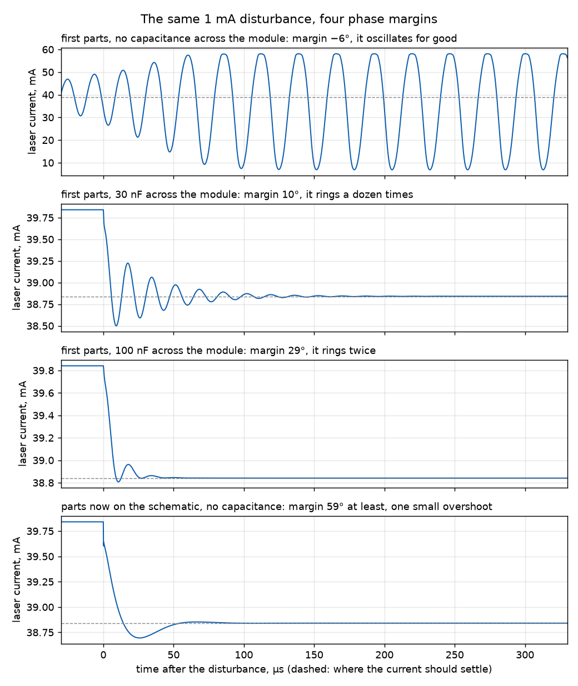

# Laser board: SPICE runs

Netlists for LTspice, to answer a few questions about the
[schematic](../../laser-board-schematic.md) before it is drawn and laid
out. One channel and the enable circuit; the rest of the board is
dividers and decoupling and needs no simulating.

**Run on 2026-11-13 in LTspice 26.1.1; the results are below.** The
lasers are fitted to their measured sweeps. The op-amp, MOSFETs and
diode are approximations, but the two things the stability depends on
are the makers' own: the op-amp's output impedance from Microchip's
model, and the sink MOSFET's gate capacitances from Nexperia's. Run
with Nexperia's model itself, the phase margins come out within 3° of
these.

## What the runs found

1. **With the loop parts first drawn (220 Ω, 1 kΩ, 10 nF), a channel
   oscillated when its module had no capacitance of its own.** The
   amplifier's own loop had a phase margin of −6° there, and 19° to
   29° with 0.1 to 10 µF across the module; the laser's current swung
   to 58 mA around a 40 mA set point. The causes are the MCP6V34's
   output impedance (about 6 kΩ above 42 kHz) and the sink's gate
   capacitance (585 pF, plus up to 900 pF to its drain): the amplifier
   cannot drive the gate through 220 Ω, nor 1 kΩ and 10 nF of
   feedback.
2. **Three values fixed it, at the same time constant, and are now in
   the schematic and in `board.inc`**: Rn03 3.9 kΩ, Rn06 10 kΩ, Cn02
   1 nF. The amplifier's loop has 64° to 76° and the current loop 59°
   to 78°, for any module capacitance from none to 10 µF (62° to 75°
   and 62° to 79° with Nexperia's own model). No overshoot on the
   ramp, a step or the enable. Neither change works alone: a larger
   gate resistor is not enough, and a lighter feedback network alone
   makes it worse. The price is rail ripple between 1 and 10 kHz,
   finding 5. What a phase margin is, with this board's curves:
   [below](#what-a-phase-margin-is).
3. **A laser takes more than its set point for a fraction of a
   millisecond after its cable reconnects, or after the 5 V rail dips
   and returns.** In both cases the loop cannot reach its set point,
   the amplifier goes to its rail, the sink is fully on, and the laser
   sits across 5 V until the loop unwinds:

   | | Set | Peak after a reconnect | Peak after a rail dip | Lasts |
   |---|---|---|---|---|
   | Laser 1 | 44 mA | 75 mA | 60 mA | 0.1 to 0.2 ms |
   | Laser 2 | 40 mA | 60 mA | 52 mA | 0.1 to 0.2 ms |

   Laser 1 was tested to 43.5 mA and laser 2 to 40.7 mA. Lasers 3 to 6
   have their own drivers, which take over above their switch points;
   the models stop there, so the runs cannot say what they do. Whether
   75 mA for 0.1 ms matters is in the diodes' datasheets, not here.
   A resistor in series with the laser caps it: 22 Ω for laser 1
   (48 mA at most) and 15 Ω for laser 2 (44 mA), at the cost of
   headroom, so the rail must then really be 5 V.
4. **The enable fault is real, and the schematic's fix holds.** With
   the Pi off and the SKR on, the draft's enable line sits at 1.0 V
   when the dead ESP32's rail is well loaded, and a laser left at
   40 mA stays at 36 to 40 mA for clamp thresholds of 1.3 and 1.5 V.
   Through Q1, the line is at 3.3 V and the laser off in all nine
   cases.
5. **Rail ripple reaches the laser little, less so above 1 kHz**:
   0.002 mA per volt at 100 Hz, 0.05 at 1 kHz, 1.9 at 10 kHz, against
   30 mA per volt on a plain supply. The larger gate resistor costs
   this: the drain's ripple reaches the gate through the MOSFET's own
   capacitance, and the gate is no longer held stiffly. The SKR's 5 V
   has little at those frequencies; its regulator's switching ripple,
   far higher up, is for the scope on the prototype.
6. **The divider is 5.02, not 5**: asking for 40 mA gives 39.84 mA
   (40.2 kΩ and 10 kΩ). Calibration takes it out, as planned.

## What a phase margin is

The channel is a loop: the amplifier compares the sense resistor's
voltage with the set point and moves the sink's gate to correct the
difference. A correction takes time to go round, and each stage on the
way (the amplifier, the gate's capacitance, the feedback capacitor)
delays it a little more.

For a ripple at one frequency, a delay is a fraction of that ripple's
period, counted in degrees: 360° is a whole period late, 180° is half
a period, which is the ripple upside down. A correction that arrives
180° late no longer opposes the error. It adds to it.

- At low frequencies the loop is strong and nearly on time.
- As the frequency rises the loop gets weaker and later.
- At one frequency, the **crossing**, the loop's strength has fallen
  to exactly 1: a ripple goes round and comes back the same size.

**The phase margin is how far the delay still is from 180° at the
crossing.** Zero means a ripple there comes back the same size and
exactly in step, and never dies: an oscillator. Negative means it
comes back in step while the loop still amplifies, so it grows until
something clips.

| Margin | After a disturbance |
|---|---|
| below 0° | oscillates for good |
| 10° to 30° | rings many times before it settles; noise near the crossing is amplified |
| 45° | overshoots by about a fifth, rings once or twice |
| 60° | a small overshoot, then settled: the usual target |
| 90° | no overshoot, slower |

The figure is this board, from `plot_margins.py`: a laser at 40 mA,
1 mA pushed into the sense resistor at time zero, so the loop has to
take 1 mA off the laser.

There are two loops here, one inside the other, each with its own
crossing and margin, and run 02 measures both:

- **The current loop**, through the sink and the sense resistor,
  crossing near 11 kHz.
- **The amplifier's own loop**, through Cn02 straight back to its
  input, crossing near 100 kHz. This is the one that was in trouble.

Why it was: the MCP6V34 is a low-power amplifier and its output is
weak, about 6 kΩ at 100 kHz. A weak output charging a capacitance is a
delay. It was asked to drive the gate's capacitance through 220 Ω and
a 1 kΩ, 10 nF feedback network, and the delay ate the margin. The fix
asks less of it: a feedback network ten times lighter (10 kΩ, 1 nF),
and 3.9 kΩ between it and the gate, so its own loop no longer feels the
gate's capacitance. That resistor slows the gate, which costs the
current loop some of its margin (88° down to about 60°): the values
are the balance where both loops have about 60° or more.

Why the module's capacitance mattered: the sink's gate and drain are
coupled by the MOSFET's own capacitance. With nothing across the
module, the drain's voltage swings as the current changes and pushes
back on the gate. A capacitor across the module holds the drain still.

## The runs

Every run lights **laser 2 at 40 mA** unless said otherwise.

| Run | Question | Result |
|---|---|---|
| `01_ramp_and_step` | Overshoot on the ramp, or on a 1 mA step? | none (under 1 µA); the step reaches 90 % in 0.19 ms; 0.84 V of headroom on the sink |
| `02_loop_gain` | Stable, whatever the module's capacitance? | amplifier's own loop 64° to 76° at 110 to 130 kHz; current loop 59° to 78° at 11 kHz |
| `03_enable` | Does the enable switch cleanly? How fast can it chop? | no overshoot; on in 0.19 ms, off in 20 µs; at 1 kHz it still reaches 99.8 % of the set point, with rounded edges |
| `04_rail_ripple` | How much rail ripple reaches the laser? | 0.002, 0.05 and 1.9 mA per volt at 100 Hz, 1 and 10 kHz; 4 to 13 at 100 kHz |
| `05_faults` | A cable that opens and returns; a shorted module | 55 to 60 mA for 0.07 to 0.14 ms on return (finding 3); shorted, the sink holds its current at 0.18 W; as the short lifts the laser sees 40 to 48 mA briefly |
| `06_off_currents` | What does an unlit laser carry? | 10 µA clamped with the DAC left at its set point; 4 µA with the DAC at zero (2 from the divider, the rest the MOSFET model's leakage); enabled with the DAC at zero, 3, 16 and 33 µA for a DAC zero of 0, 0.8 and 1.6 mV |
| `07_pi_off` | Pi off, SKR on, laser lit: does the enable hold it off? | finding 4 |
| `08_rail_up_and_dip` | Light as the 5 V rises? Overshoot after a dip? | under 5 µA as it rises; a dip to 3.6 V drops the current to 27.5 mA, and it returns to 52 mA for 0.23 ms before settling |

Two results to read with care:

- **Run 05's 350 mA** (`i_short_ma`) is a spike of a few microseconds
  through the sink as the short lands. The laser is shorted then and
  carries none of it.
- **Run 04 prints decibels.** −57 dB of mA per volt is 0.0014 mA per
  volt (10 to the power of dB/20).

## Running them

`python run_all.py` runs all eight and prints every measurement;
`python run_all.py 05 08` runs those two. LTspice is looked for in its
usual places, or at the path in the `LTSPICE` environment variable.

By hand: in LTspice, File, Open, "Netlists (*.cir)", then Run. The
numbers are under View, SPICE Error Log, once per step. For curves,
Plot Settings, Add trace: each file's header says what to plot, and
`V(sns)*100` is the sink's current in mA.

`python check_netlists.py` checks the netlists without a simulator
(undefined names, wrong pin counts, dangling nodes).

## The files

| File | What it is |
|---|---|
| `models.lib` | the parts: op-amp, MOSFETs, diode, the six lasers |
| `board.inc` | the supply's passives, the enable and lid circuit, channel 1, with the schematic's designators |
| `01` to `08` | the runs |
| `run_all.py`, `check_netlists.py` | the runner and the static check |
| `plot_margins.py`, `phase-margin.png` | the figure above and what draws it |

To try another laser, change `LASER2` on a run's `Xlas` line and
`ISET` at its top. The most each should be set to: 44, 41, 21, 22,
18.5 and 11 mA for lasers 1 to 6. `DUMMY100` is the 100 Ω load.

Run 02 opens the loop in two places in turn. `t_overall` (at the
amplifier's inverting input) is everything the amplifier feeds back to
itself; `t_current` (at the sense resistor) is the current loop alone.
Each reads (0 dB, phase margin) at its crossing frequency. Each fails
in the steps where the other's loop is the one open: that is expected.

## What is modelled, and how well

- **The lasers are measured**: a diode and a series resistance fitted
  to each module's forced-current sweep in `bench-results/`
  (2026-11-10 and -11), from 1 mA to the top of its tested range. The
  fit is within 22 mV for lasers 1 and 2 and 4 mV for the others.
  Light is the measured threshold and mW per mA, as a straight line:
  `V(opt)` is in mW, and overstates the light where a real laser's
  curve bends.
- **Not modelled**: the drivers inside lasers 3 to 6, any capacitance
  inside a module (hence `CMOD`, stepped), and whatever made lasers 1
  and 2 oscillate with the miniSMU's voltage loop. A clean run 02 does
  not clear them: the prototype channel on a scope still has to.
- **The op-amp, MOSFETs and diode are approximations** from datasheet
  typical values, with two things taken from the makers' models. The
  op-amp has one pole, a plain clamp at the rails and no current
  limit; its output impedance (50 Ω, rising from 350 Hz to 6 kΩ above
  42 kHz) is the network in Microchip's MCP6V31 model, revision E. The
  PMV30UN2's gate resistance and capacitances are those in Nexperia's
  model; its threshold and gain are datasheet values.
- **Not modelled at all**: the layout, the ESP32's ADC, the LP5907
  (the 3.3 V is ideal except in run 08), temperature.

## Using the makers' models

Each part is called through a wrapper in `models.lib`, so a maker's
model goes in at one place:

- **Op-amp**: Microchip's MCP6V31 model (`MCP6V31_MM_E.zip`, from
  the product page) **does not converge in LTspice 26.1.1**, even alone
  as a follower: it is written for PSpice. Tried without success
  (2026-11-13): plain resistors for its resistor models, parentheses
  on its diode models, its noise sources removed, the alternate
  solver. Its pin order is the wrapper's (+ input, − input, V+, V−,
  output), so if a later LTspice or an edited copy runs it, it goes in
  with `.include` and `X1 inp inn vdd vss out MCP6V31` inside
  `.subckt OPAMP`. PSpice or TINA would run it as it is.
- **Sink MOSFET**: Nexperia's PMV30UN2 model (from its product page,
  under Documentation) runs in LTspice as it is. Saved here as
  `PMV30UN2.lib`, it goes in with `.include PMV30UN2.lib` and
  `X1 d g s PMV30UN2` inside `.subckt SINKFET`; its pins are drain,
  gate, source. **It is licensed, not ours to publish: git ignores
  it**, and `models.lib` does not depend on it. Tried 2026-11-13: the
  phase margins with the first parts were −7° and 25° against the
  approximation's −6° and 23°. For the AO3400A, change `PMV30UN2_APX` to
  `AO3400A_APX` there (its capacitances are guesses).
- **BSS138, BAT54**: the same, inside `CLAMPFET` and `RDIODE`. Run 07
  steps the clamp's threshold through `VTC`, which a maker's model
  will not follow: keep the approximation for that run.

Check the pin order in each downloaded file's `.SUBCKT` line before
trusting it.

## Sweeping other things

Each run has a `.step` line. Any parameter can take its place:

- `VTS`: the sink's threshold, 0.45 to 0.95 V.
- `LCAB`: the cable's inductance; 0.5 µH is about half a metre.
- `C105V`: the capacitor footprint across the module, 0 or 100n.
- `RLID`: 0.1 with the lid shut, 1G open (run 03 then stays dark).
